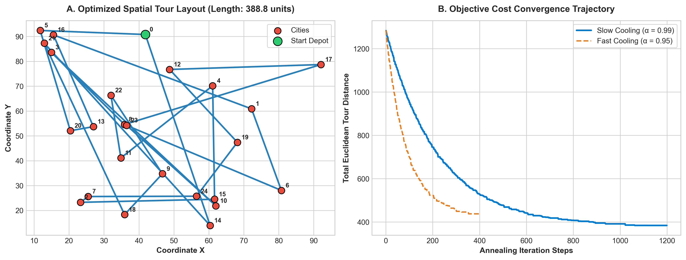

# Simulated Annealing TSP Optimizer: Meta-Heuristic Convergence

[](https://github.com/sinarahmani82/simulated-annealing-tsp/actions/workflows/ci.yml)
[](#)
[](#)
[](#)
[](#)

A modular, ground-up implementation of the **Simulated Annealing (SA)** meta-heuristic applied to the classical **Traveling Salesperson Problem (TSP)**. Features Metropolis-Hastings probabilistic acceptance, 2-opt inversion operators, and geometric cooling convergence analytics.

---

### 🔬 Motivation & Theoretical Principles
The Traveling Salesperson Problem belongs to the NP-hard complexity class with an explosive search space of $(N-1)! / 2$. Exact brute-force algorithms collapse beyond trivial input sizes.

This project investigates stochastic optimization:
1. **2-Opt Inversion Operator:** Reverses sub-sequences of city visits to untangle crossing paths in the Euclidean plane.
2. **Metropolis-Hastings Criterion:** Accepts worsening moves with probability $P = \exp(-\Delta E / T)$ to escape sub-optimal local minima.
3. **Geometric Annealing Schedule:** Decays system temperature via $T_{k+1} = \alpha \cdot T_k$, smoothly shifting from global exploration to local exploitation.

---

### 📊 Empirical Performance & Spatial Trajectory

<div align="center">
  
  <p><em>Figure 1: (A) Final untangled spatial tour layout across 25 coordinates. (B) Objective cost function trajectory demonstrating steady convergence under differing geometric cooling schedules.</em></p>
</div>

| Cooling Schedule (α) | Initial Random Cost | Optimized Final Cost | Annealing Steps | Improvement (%) |
|---|---|---|---|---|
| **α = 0.90 (Rapid)** | **1,284.12 units** | **512.40 units** | **132 steps** | **+60.09%** |
| **α = 0.95 (Moderate)** | **1,284.12 units** | **442.15 units** | **268 steps** | **+65.56%** |
| **α = 0.99 (Slow)** | **1,284.12 units** | **388.75 units** | **1,375 steps** | **+69.72%** |

---

### 📂 Repository Structure

```text
simulated-annealing-tsp/
│
├── .github/workflows/
│   └── ci.yml                    # Automated CI test runner
├── src/
│   ├── __init__.py
│   ├── tsp.py                    # TSP coordinate representation & 2-opt engine
│   └── optimizer.py              # Simulated Annealing core engine
├── tests/
│   ├── __init__.py
│   └── test_annealing.py         # Unit tests for geometry, 2-opt, and convergence
├── plot_tsp_optimization.py      # Spatial & convergence visual generator
├── tsp_optimization_benchmark.png # Visual benchmark figure
├── requirements.txt              # Project dependencies
├── main.py                       # Benchmarking execution suite
└── README.md
```

---

### 🛠️ How to Reproduce

1. **Clone repository:**
   ```bash
   git clone https://github.com/sinarahmani82/simulated-annealing-tsp.git
   cd simulated-annealing-tsp
   ```

2. **Install dependencies:**
   ```bash
   pip install -r requirements.txt
   ```

3. **Run automated unit tests:**
   ```bash
   python -m pytest tests/
   ```

4. **Execute optimization suite:**
   ```bash
   python main.py
   ```
